# HelloMotion

<p align="center">
  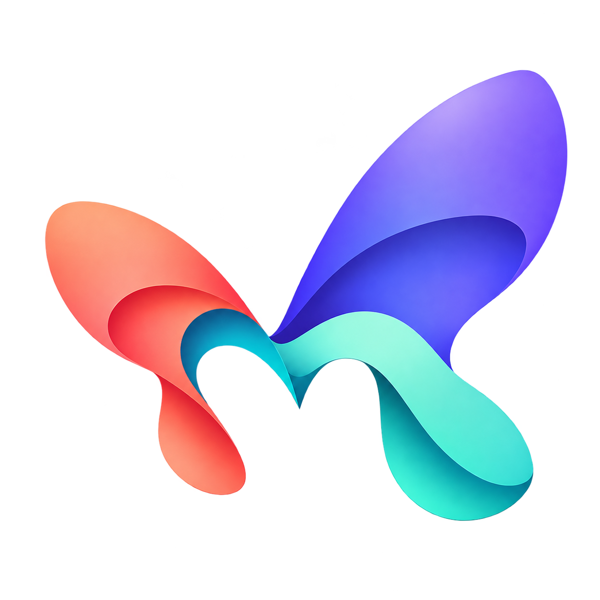
</p>

### Your hands. Your camera. A little magic.

HelloMotion is a free, open-source Windows app that turns hand gestures into animated reactions during video calls. Make a heart with your hands, open a glowing portal, send jellyfish drifting through the frame, or let a golden phoenix take flight. You can trigger every effect with a button, too.

The app combines your webcam and the effects into one **virtual camera**. Select **HelloMotion (Windows Virtual Camera)** in Google Meet or WhatsApp Desktop, and the other person sees the animation as part of your video. They do not need HelloMotion installed.

Hand recognition and rendering run on your computer. The project is inspired by the playful gesture reactions on macOS, with its own collection of fourteen effects for Windows.

A looping, text-drawn version of the journey from a wave to a video-call reaction. The actual effects are pictured together below.

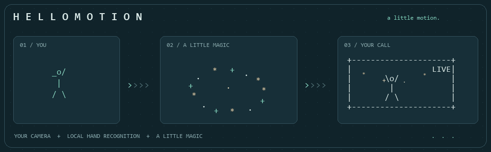


**Windows 11 x64** / **14 effects** / **8 in 3D** / **MIT licensed** / **Preview 0.5.1**

[Get started](#start-using-hellomotion) · [Gesture guide](#effects-and-gestures) · [Build it](#set-up-a-fresh-checkout) · [How it works](#from-a-gesture-to-the-other-side-of-the-call) · [All effect images](#the-effect-gallery)

> **A project in motion.** HelloMotion is a working development preview. Local rendering and camera tests pass; live gesture accuracy, calling-app behavior across different machines, and installer upgrades still need broader testing.

## Start using HelloMotion

If you have a built installer, close HelloMotion before installing or updating it. The unsigned installer includes the gesture model and native camera component, and requires administrator access to register the camera. This repository does not yet provide a tested public release.

1. Open HelloMotion and click **Start camera**. Select your physical webcam in HelloMotion.
2. Turn **Call output** on.
3. Choose **HelloMotion (Windows Virtual Camera)** as the camera in your calling app.
4. Turn **Gestures** on, or click an effect button. Scroll the effect picker to see all fourteen.
5. Hold a static gesture for about 800 ms. Relax your hands before repeating; reactions share a three-second cooldown.

**Ctrl + Shift + H** toggles gesture recognition. **Test pattern** lets you check output without opening a webcam. The preview is mirrored; outgoing webcam video is normally oriented. Keep HelloMotion running during your call; minimizing it keeps frame production active. Stopping the camera clears outgoing video, and closing HelloMotion removes its session camera.

## Effects and gestures

| Effect | Gesture | Animation |
| --- | --- | --- |
| Hearts | Heart hands | Glossy red hearts rise from the hands. Heart recognition remains experimental. |
| Thumbs up | One thumbs up | Golden thumbs-up bubbles rise and shimmer. |
| Balloons | One peace sign | Shaded balloons float upward with swaying strings. |
| Rain | Two thumbs down | Clouds, rain, and lightning. |
| Confetti | Two peace signs | A burst of tumbling confetti. |
| Fireworks | Two thumbs up | Rockets burst into sparks and trails. |
| Flower bloom | Closed fist, then open that palm | A stem grows and layered 3D petals unfold and drift away. |
| Butterflies | Two open palms | Seven butterflies flap their hinged wings and fly outward. |
| Magic sparkles | Index finger pointing upward | A glowing star and flowing trail follow the fingertip. |
| Silk ribbons | Wave one open palm side to side twice | Twisting 3D satin ribbons flow across the frame. |
| Galaxy portal | Two closed fists | Metal rings, orbiting crystals, and a swirling luminous centre. |
| Jellyfish ballet | Open palm + peace sign | Three glowing jellyfish pulse and drift with flowing tentacles. |
| Snow globe | Open palm + thumbs up | Falling snow, trees, and a house inside a glass globe. |
| Golden phoenix | Thumb, index, and pinky extended; middle and ring fingers folded | A golden bird rises with feathered wings, trailing plumes, and embers. |

All effects have manual buttons. The video effects use custom artwork and geometry; emoji are used only as button labels.

## Run the existing development checkout

On this laptop, the project is in `D:\Project\video-effects`:

```powershell
cd D:\Project\video-effects
npm start
```

Close the previous instance before starting another. Dependencies, the local model, native binaries, and development camera registration have already been prepared on this laptop.

## Set up a fresh checkout

Requirements: Windows 11 x64, Node.js (tested with version 24), and Visual Studio 2022 Build Tools with Desktop development with C++ and the Windows 11 SDK. An 8 GB laptop is the target; performance across different laptops is still being evaluated.

```powershell
git clone https://github.com/srisaidhakshini/video-effects.git
cd video-effects
npm ci
npm run setup
npm run camera:build
```

From an **administrator PowerShell** in the repository, register the native camera source once:

```powershell
powershell -NoProfile -ExecutionPolicy Bypass -File scripts/setup-camera.ps1
```

Then launch normally with `npm start`. Development registration points to this checkout, so keep it in place. See [native/README.md](native/README.md) for the camera architecture and removal instructions.

## From a gesture to the other side of the call

```text
                         ON YOUR COMPUTER

  +-------------+     +-------------------+     +----------------+
  | Your webcam |---->| Recognize a hand  |---->| Choose a moment |
  +-------------+     | in a local worker |     +-------+--------+
         |            +-------------------+             |
         |                                      +-------v--------+
         |                                      | Animate in 3D  |
         |                                      | in its worker  |
         |                                      +-------+--------+
         |                                              |
         +--------------------+-------------------------+
                              v
                   +----------------------+
                   | Webcam + animation   |
                   | = HelloMotion camera |
                   +----------+-----------+
                              |
                              v
                   +----------------------+
                   | Your video-call app  |
                   +----------------------+
```

### Built to keep the conversation moving

- Gesture recognition runs in a background worker, with one frame in flight. Brief uncertain predictions preserve hold progress; a neutral release is required before repeating a pose.
- All eight 3D effects render in a separate OffscreenCanvas worker. Geometry setup and shader compilation do not block the camera's drawing loop. Effect scenes are cached, with at most eight cached scenes and three active effects.
- A single background timer targets 24 fps for camera production, including while minimized. Only one output IPC frame is in flight; missed work is dropped instead of queued.
- The native source advertises 960 x 540 RGB32/NV12 at 30 fps. A pipe-reading worker updates a latest-frame cache; sample requests copy completed frames without waiting for pipe I/O. Native delivery is paced, with QPC-based timestamps.
- Brief interruptions repeat the most recent frame. The server and native reader each expire their cache after 1.5 seconds without a fresh update. Explicit camera stop clears the server buffer immediately; the next completed native poll receives black.

After an update, close and reopen HelloMotion and reselect its camera in the calling app. Windows may require a camera-service refresh or restart to release an older loaded camera DLL.

## Checks and packaging

| Command | Checks or output |
| --- | --- |
| `npm test` | Gesture mappings, motion sequences, hold/release/cooldown, anchors, and frame transport. |
| `npm run smoke` | Desktop controls, local model initialization, and test-pattern start/stop. |
| `npm run gestures:check` | Eight checks using Google's sample photos and constructed two-hand fixtures. Downloads fixtures into ignored `work/` if needed. |
| `npm run effects:check` | All fourteen effects: visible rendering, expiry, cleanup, and bounded scene caching. |
| `npm run effects:worker-check` | Images and clearing for all eight worker-rendered 3D effects. |
| `npm run camera:reader-test` | Native cache behavior during connection gaps, explicit clearing, stale-frame expiry, and recovery. |
| `npm run camera:test` | Native Windows capture of expected test pixels. |
| `npm run camera:smoke` | Electron canvas through IPC, pipe, and Windows virtual-camera capture. |
| `npm run camera:stability -- --with-effects` | Six seconds of minimized virtual-camera capture with creative effects, checking motion, black frames, timestamps, and delivery rate. |
| `npx electron . --producer-stability` | Eight seconds of minimized frame production with creative effects in an isolated buffer; does not activate a second Windows virtual camera. |
| `npm run effects:preview` | Still images and motion contact sheets under `work/effects-preview/`. |
| `npm run effects:demo` | A generated-background video of the latest four effects, without capturing a webcam. |
| `npm run dist` | Unsigned Windows installer under `dist/`; build the native camera first. |

Close other HelloMotion instances before tests that activate the Windows virtual camera. Camera tests open only HelloMotion's virtual device; they do not open a physical webcam.

**Verified locally:** 19 automated tests; all eight worker-rendered effects; packaged desktop/model initialization; and minimized frame production with the latest four effects, with zero black frames. The 0.4.1 native output path also passed Windows capture and minimized stability checks. For 0.5.0, an isolated producer test preserved the existing call instead of replacing its virtual camera.

**Still needs validation:** live-camera accuracy of the new gestures, real calls in Meet and WhatsApp across machines, sustained performance on 8 GB laptops, and clean-machine installation, updates, and removal. Sample-photo and generated-pattern tests do not establish real-world gesture accuracy or calling-app compatibility. This is a development preview.

## Your camera stays yours

Camera frames and recognition stay on the device. HelloMotion has no account requirement, analytics, microphone capture, webcam recording, video uploads, or network listener. Setup downloads dependencies and the gesture model; runtime assets are local. The optional demo command records only a generated background and effects.

Frames travel through an unpredictable local Windows named pipe and remain in memory. Explicit pipe access controls, security review, and broader CPU/latency measurements remain release work. Build output, downloaded models, dependencies, test fixtures, and generated demos are excluded from Git.

## Brand assets

The coral, violet, and mint butterfly-ribbon logo represents movement and transformation. The full logo, transparent symbol, and multi-resolution Windows icon live in [`app/assets/`](app/assets/). The symbol appears in the app header and camera placeholder, window/taskbar icon, installer, uninstaller, and installed shortcuts. See [the brand notes](docs/branding.md) for asset usage and design provenance.

## The effect gallery

**All fourteen effects, together.** These are renders from HelloMotion on a generated background. In a call, the effects are composited over your webcam video. The first six use custom procedural artwork; the remaining eight use 3D geometry, lighting, and depth.

### The everyday reactions

| Hearts | Thumbs up |
| :---: | :---: |
| 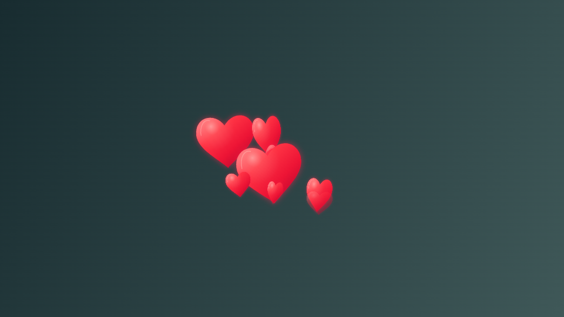 | 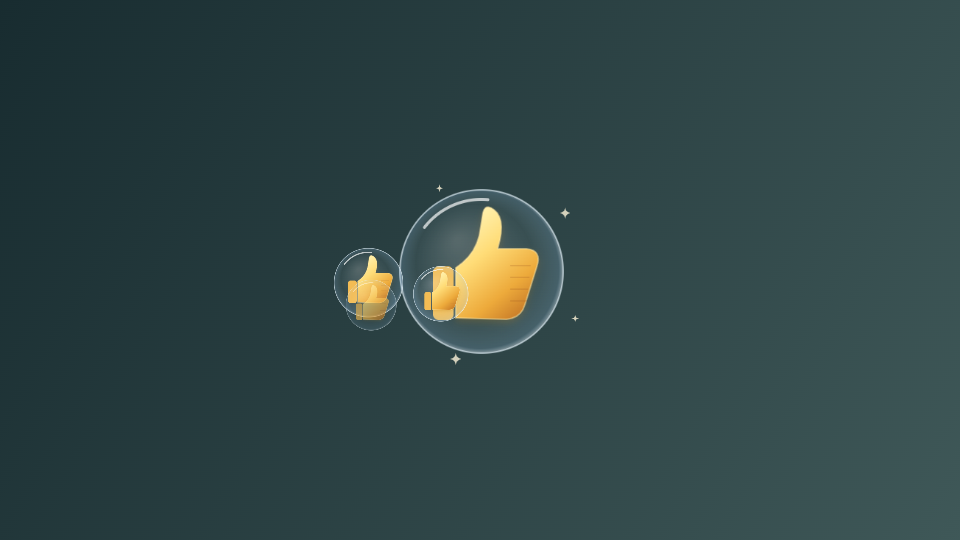 |
| **Heart hands** | **One thumbs up** |

| Balloons | Rain |
| :---: | :---: |
| 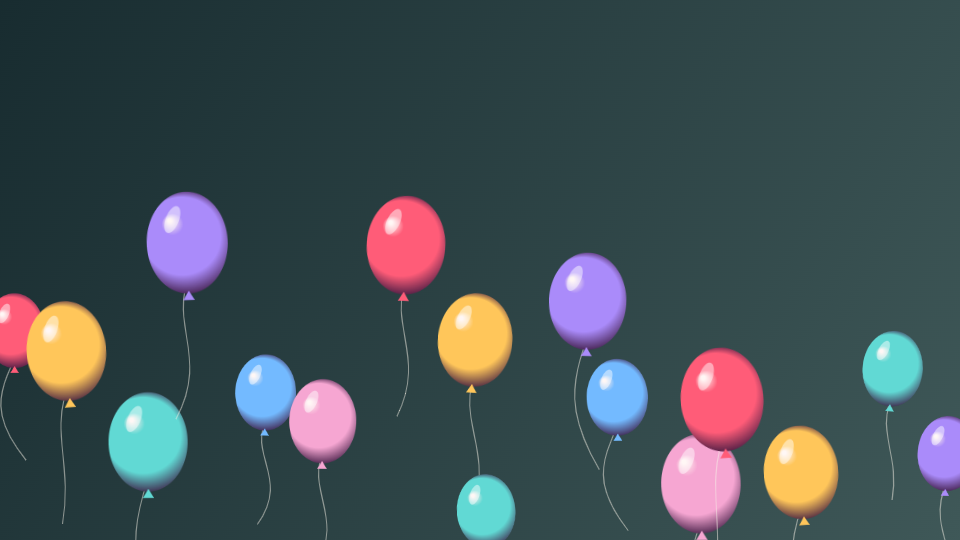 | 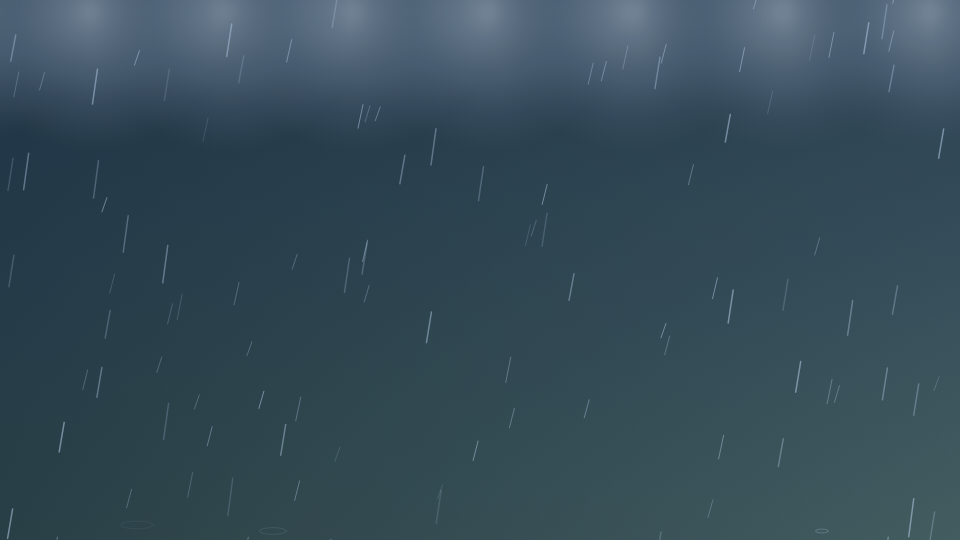 |
| **One peace sign** | **Two thumbs down** |

| Confetti | Fireworks |
| :---: | :---: |
| 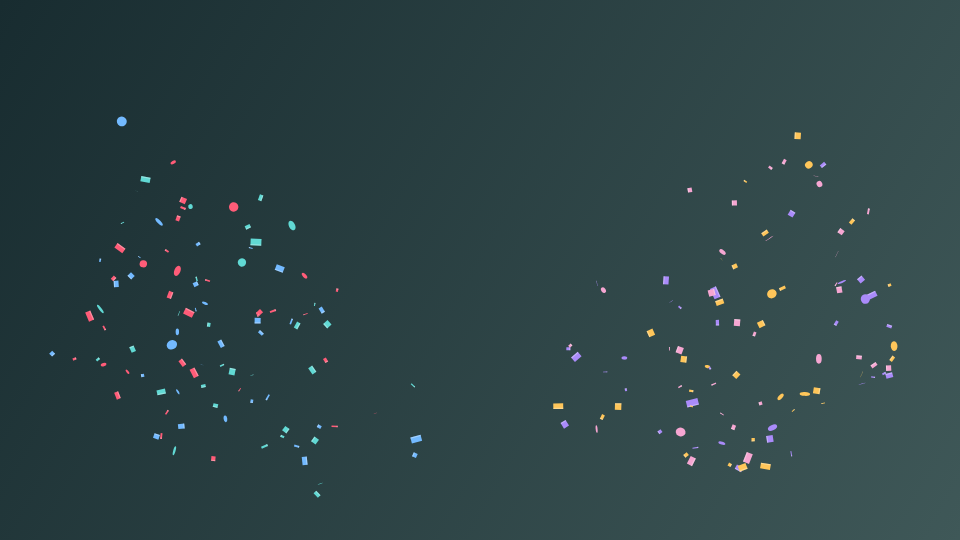 | 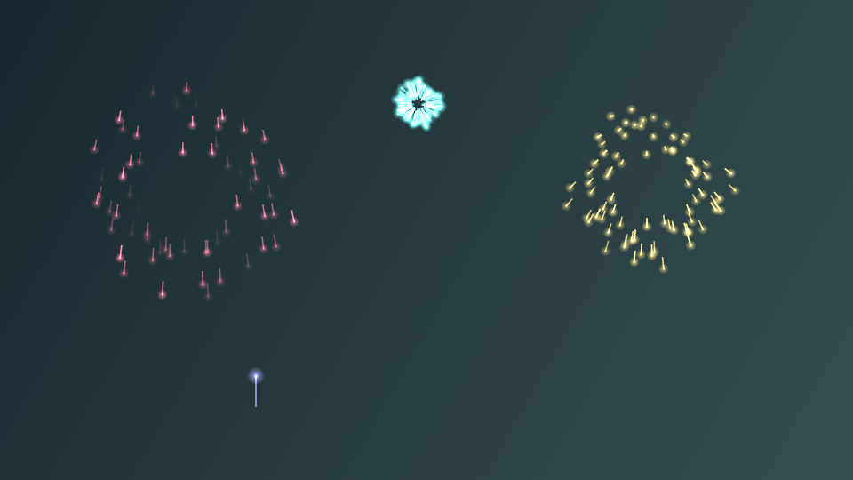 |
| **Two peace signs** | **Two thumbs up** |

### A little wonder in 3D

| Flower bloom | Butterflies |
| :---: | :---: |
| 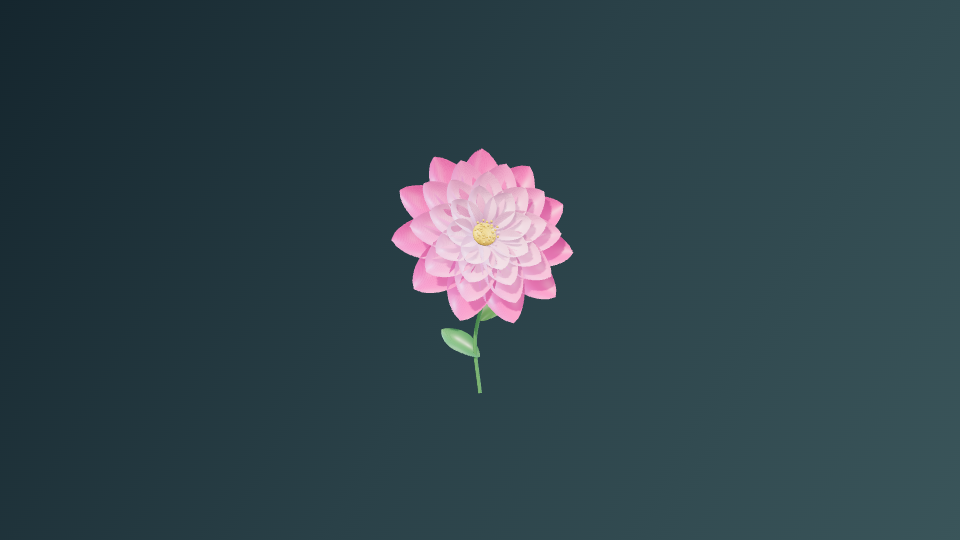 | 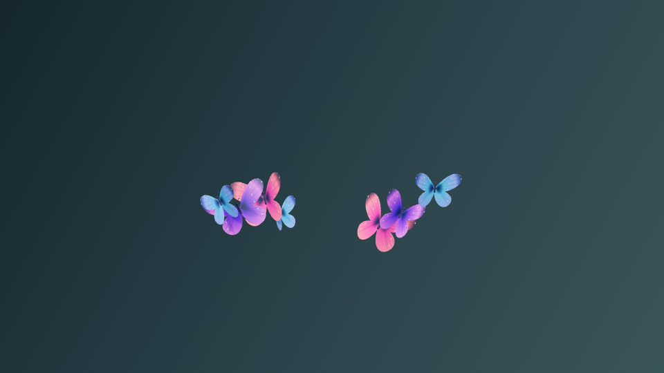 |
| **Closed fist, then open palm** | **Two open palms** |

| Magic sparkles | Silk ribbons |
| :---: | :---: |
| 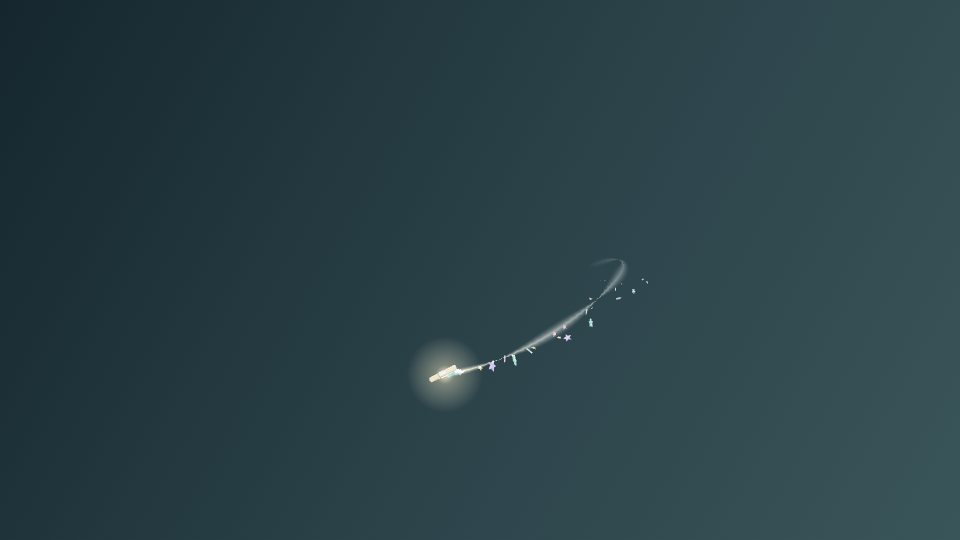 | 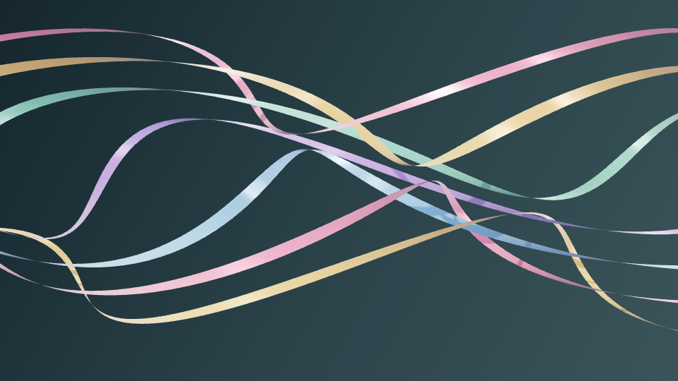 |
| **Point your index finger up** | **Wave one open palm** |

### The imagination collection

| Galaxy portal | Jellyfish ballet |
| :---: | :---: |
| 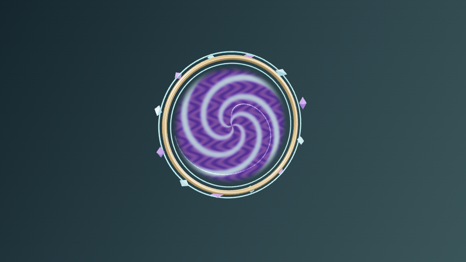 | 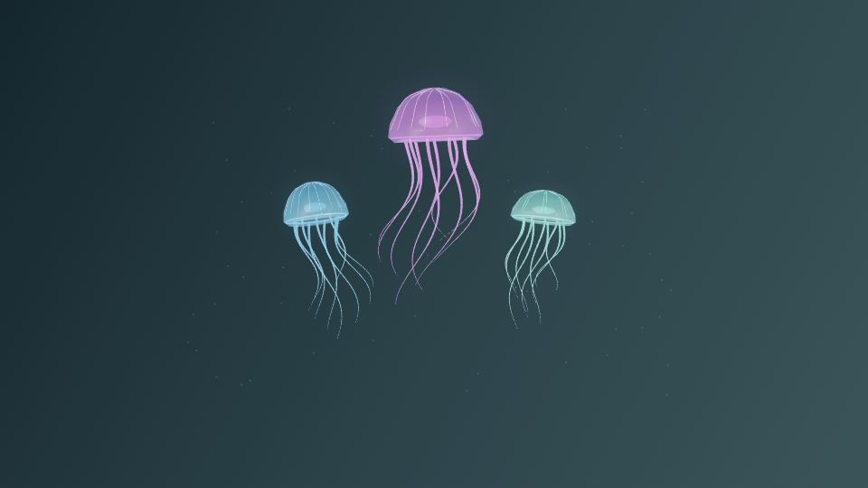 |
| **Two closed fists** | **Open palm + peace sign** |

| Snow globe | Golden phoenix |
| :---: | :---: |
| 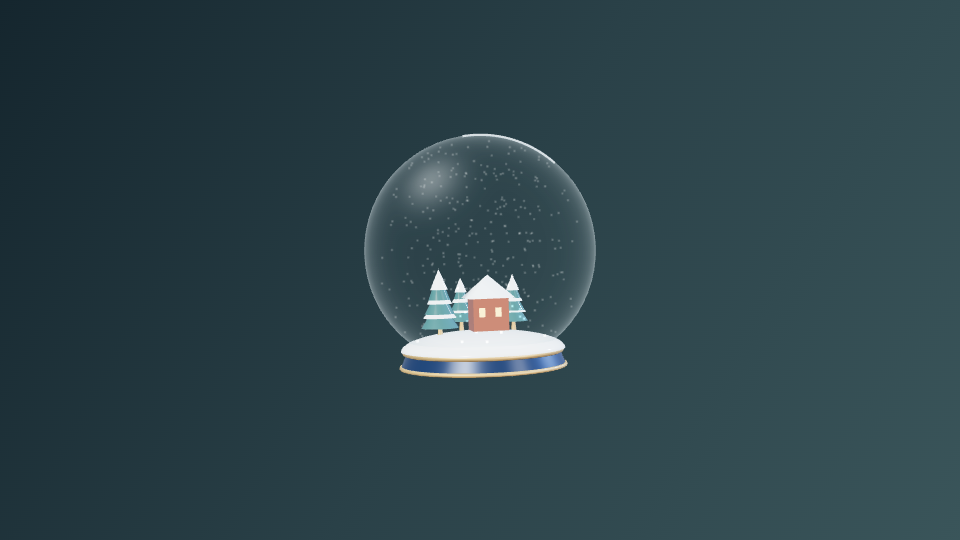 | 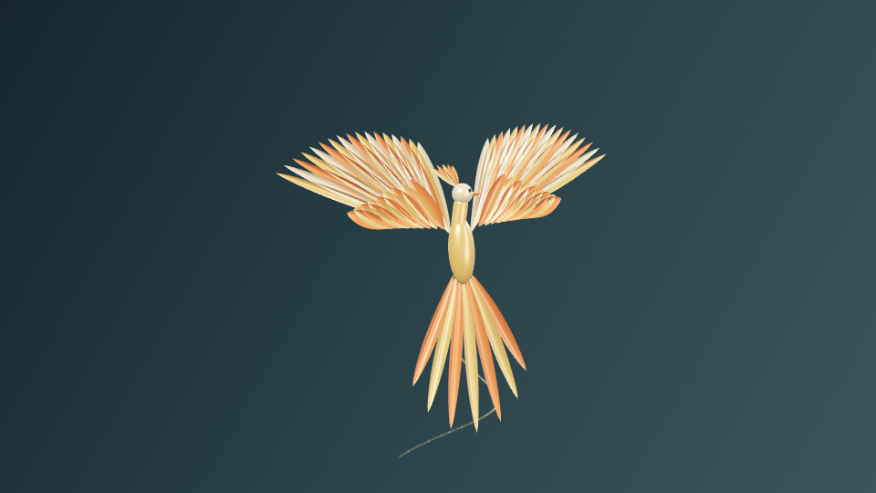 |
| **Open palm + thumbs up** | **Thumb, index, and pinky extended** |

```text
           .       *                     .
       *       thanks for stopping by        +
            .                        *
                 \o/   say hello.
                  |    make a little motion.
                 / \
```

## License and credits

HelloMotion is [MIT licensed](LICENSE).

- Native media-source foundation: Microsoft's [Windows-Camera sample](https://github.com/microsoft/Windows-Camera/tree/master/Samples/VirtualCamera), commit `626f8b19c5f367602f2e89c6b314573d3776c9df`. Original copyright and MIT notices are retained under `native/` and bundled with the installer.
- Gesture recognition: [Google MediaPipe Tasks Vision](https://developers.google.com/edge/mediapipe/solutions/vision/gesture_recognizer/web_js).
- 3D rendering: [Three.js](https://threejs.org/), with its MIT license bundled under `notices/Three.txt`.
- Windows camera API: [MFCreateVirtualCamera](https://learn.microsoft.com/en-us/windows/win32/api/mfvirtualcamera/nf-mfvirtualcamera-mfcreatevirtualcamera).


---
