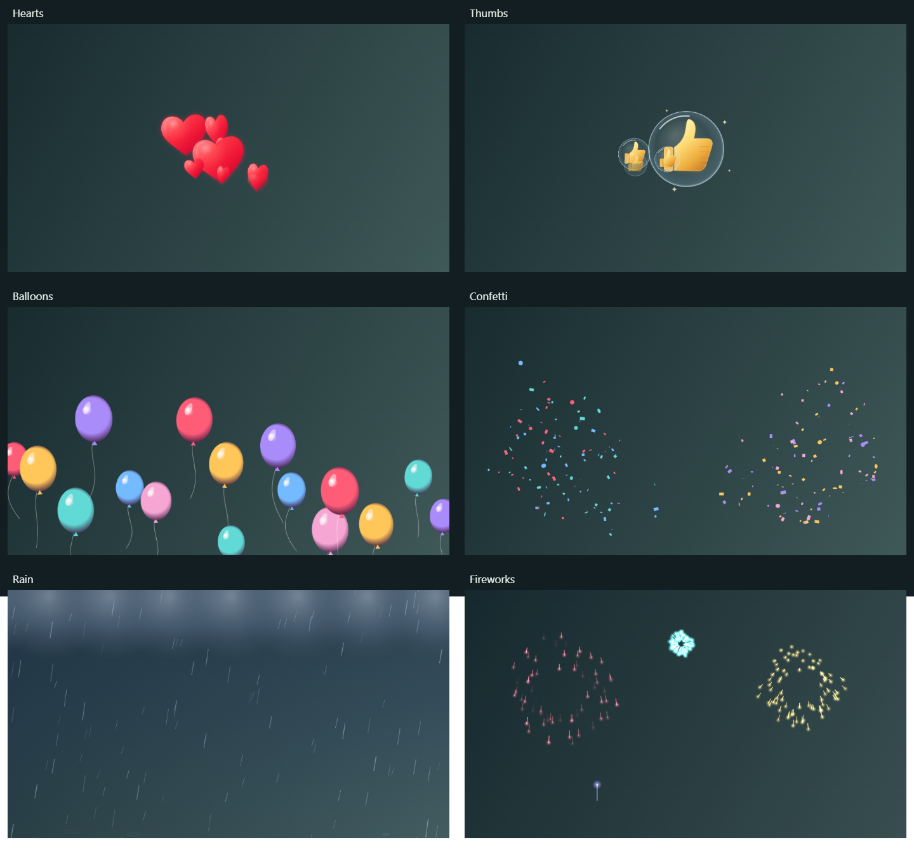

# HelloMotion

Free, open-source gesture reactions for Windows 11 x64. Development preview **0.3.1**.



## Run on this laptop

```
cd D:\Project\video-effects
npm start
```

The dependencies, local model, native camera binaries, and development camera registration are prepared on this laptop.

1. Start your camera, or use **Test pattern** without a webcam.
2. Enable **Call output**.
3. Select **HelloMotion (Windows Virtual Camera)** in your calling app.
4. Enable **Gestures**, or click a reaction button. Ctrl+Shift+H toggles gestures.

Only the preview is mirrored; outgoing webcam video is normally oriented. Closing HelloMotion removes its session camera. Stopping the webcam clears outgoing video.

## Features and verification

Six custom procedural animations: glossy red hearts emitted from the detected hand position; golden thumbs-up glass bubbles; shaded balloons with swaying strings; ballistic confetti; cloud/rain/lightning scene; and fireworks with rocket trails and spark bursts. No emoji glyphs are used in the video effects. Reaction buttons retain emoji labels. Local MediaPipe recognition with an 800 ms hold, 3 second cooldown, and release before retrigger. Heart hands uses an experimental heuristic. Native camera: RGB32/NV12, 960x540.

| Hearts | Thumbs up | Balloons |
| :---: | :---: | :---: |
|  |  |  |

| Confetti | Rain | Fireworks |
| :---: | :---: | :---: |
|  |  |  |

Verified: gesture logic; frame protocol/color conversion/stale-frame clearing; desktop/model initialization; test-pattern rendering; native compilation; Windows capture of expected pixels; full Electron canvas to Windows virtual camera path.

Not yet verified: WhatsApp Desktop and Google Meet in real calls, physical-camera gesture accuracy, performance on 8 GB machines, and clean-machine installer/uninstaller behavior. This is not a production release.

## Fresh development checkout

Prerequisites: Node.js LTS and Visual Studio 2022 Build Tools with Desktop development with C++ and Windows 11 SDK.

```
npm ci
npm run setup
npm run camera:build
```

Register the source once in an administrator PowerShell from the repository root:

```
powershell -NoProfile -ExecutionPolicy Bypass -File scripts/setup-camera.ps1
```

Then launch normally with `npm start`. See `native/README.md` for architecture and removal instructions.

## Checks and packaging

```
npm test
npm run smoke
npm run camera:test
npm run camera:smoke
npm run dist
```

The unsigned installer bundles the model and native binaries and requires administrator access to register the camera source. Build the native camera before packaging. Installation and removal require clean-machine testing before public distribution.

## Privacy and release work

No account, analytics, microphone capture, recordings, video uploads, or network listener. Development setup downloads dependencies/model; runtime assets are local. Frames travel over an unpredictable local Windows named pipe. Explicit pipe access controls and security review remain release tasks. The initial bridge also needs CPU and latency measurements.

## Credits

Media-source foundation: Microsoft's MIT-licensed Windows-Camera sample, commit 626f8b19c5f367602f2e89c6b314573d3776c9df; notices retained under native/. Gesture recognition: Google MediaPipe Tasks Vision.

- https://github.com/microsoft/Windows-Camera/tree/master/Samples/VirtualCamera
- https://learn.microsoft.com/en-us/windows/win32/api/mfvirtualcamera/nf-mfvirtualcamera-mfcreatevirtualcamera
- https://developers.google.com/edge/mediapipe/solutions/vision/gesture_recognizer/web_js


## Gesture reliability update (0.3.1)

- Hand recognition runs in a background worker, with one frame in flight, so inference cannot block the preview/effect drawing loop.
- Fresh frame snapshots, adaptive left/right scans, and a mirrored retry for ambiguous hand orientations improve reacquisition.
- A 55% classifier cutoff replaces the overly strict 75% cutoff; the 800 ms hold and 3 second cooldown remain.
- Brief missing/incorrect predictions preserve hold progress. A real neutral release is required before repeating a held pose.
- The preview now shows the hand count, recognized reaction, and hold progress. Heart hands uses improved landmark geometry but remains experimental.

`npm run gestures:check` downloads Google's four sample photos into ignored work/ if missing, and tests them through the same background detector used by the camera. Eight checks pass: thumbs up, peace, single thumbs down (no reaction), double thumbs up, double peace, double thumbs down, pointing up (no reaction), and blank input. The two-hand fixtures are constructed by placing the sample and a mirrored copy side by side. These checks do not establish accuracy across all lighting, hand poses, or webcams.

A simulated-webcam test also verified the actual camera-start → enable gestures → hold → reaction-trigger flow, without using a physical webcam. Physical-camera validation with the user is still needed. No camera frames are saved or uploaded.
